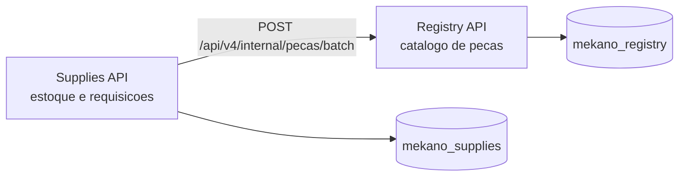
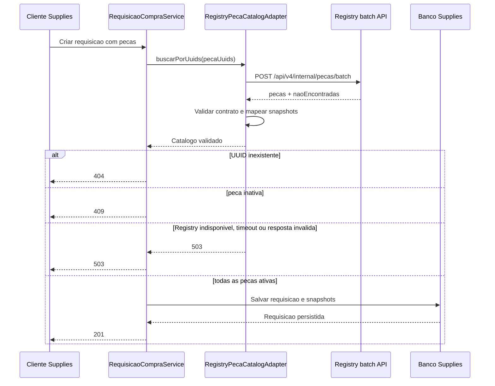

# Arquitetura — Mekano Registry Service API

## 1. Visão geral

O Registry é um serviço Quarkus independente, com banco próprio, seguindo Clean Architecture e os padrões do monólito Mekano.

```text
┌─────────────────────────────────────────────┐
│              Registry Service               │
│                                             │
│  registry-rest (Quarkus / JAX-RS / DTOs)    │
│        │                                    │
│  registry-application (use cases)           │
│        │                                    │
│  registry-domain (models/VOs/ports)         │
│        ▲                                    │
│  registry-infrastructure (JPA/repos/Flyway) │
│        │                                    │
│  PostgreSQL 16 — mekano_registry            │
└─────────────────────────────────────────────┘
```

O serviço **não depende** do Supplies. O endpoint interno de batch de peças é consumido pelo Supplies; Registry não faz chamadas ao outro serviço.

---

## 2. Módulos Maven

| Módulo | Responsabilidade | Dependências |
|---|---|---|
| `registry-domain` | Entidades, VOs, enums, ports, exceções | Java SE + Lombok |
| `registry-application` | Services/use cases, commands, orquestração | `registry-domain`, `quarkus-arc` |
| `registry-infrastructure` | Entities JPA, repositórios, mappers, migrations, auditoria | `registry-domain`, Quarkus/Hibernate/Flyway |
| `registry-rest` | Resources, DTOs, exception mapper, config Quarkus | `registry-application`, `registry-infrastructure` |

Regras:

- `@Transactional` nos services (nunca em resources/repositórios).
- Resources com `@RequestScoped`.
- DTOs de entrada como classes com Bean Validation; DTOs de saída como `record`.
- Mapeamento com MapStruct (`componentModel = "cdi"`).
- Jandex nos módulos necessários.
- Quarkus Maven Plugin apenas no `registry-rest`.

---

## 3. Pacotes

```text
com.fiap.mekano.registry
├── domain
│   ├── model
│   ├── valueobject
│   ├── port/in
│   ├── port/out
│   └── exception
├── application
│   └── service
├── infrastructure
│   ├── entity
│   ├── mapper
│   └── repository
└── rest
    ├── api
    ├── dto
    ├── exception
    └── mapper
```

---

## 4. Stack e configuração

| Item | Valor |
|---|---|
| Java | 17 |
| Quarkus | 3.36.0 |
| REST prefix | `/api/v4` |
| Banco | PostgreSQL 16 |
| Database | `mekano_registry` |
| Porta API | `8081` |
| Porta DB | `5433` |
| Migrations | Flyway |
| Documentação | SmallRye OpenAPI |
| Health/Metrics | SmallRye Health / Micrometer |

Configuração principal:

```properties
quarkus.http.port=8081
quarkus.rest.path=/api/v4
quarkus.datasource.db-kind=postgresql
quarkus.datasource.jdbc.url=${REGISTRY_DB_URL:jdbc:postgresql://localhost:5433/mekano_registry}
quarkus.datasource.username=${REGISTRY_DB_USER:mekano}
quarkus.datasource.password=${REGISTRY_DB_PASSWORD:mekano}
quarkus.hibernate-orm.schema-management.strategy=none
quarkus.flyway.migrate-at-start=true
```

---

## 5. Dependências entre serviços

```text
Supplies ──POST /api/v4/internal/pecas/batch──► Registry
Registry ──nenhuma chamada──► Supplies
```





- Comunicação síncrona REST/JSON.
- Sem broker, sem eventos, sem saga.
- Sem acesso ao banco do outro serviço.
- Timeout configurável por `REGISTRY_TIMEOUT_MS` (3 segundos por padrão); falhas de conexão, HTTP 5xx, timeout e resposta fora do contrato resultam em `503`.
- Versionamento via `/api/v4`.

O cenário E2E reproduzível está descrito em [`docs/06-operacao-local.md`](06-operacao-local.md) e roda em um Compose isolado com bancos descartáveis.

---

## 6. Camadas e responsabilidades

### Domain

- Entidades imutáveis com factories `create`/`reconstitute`.
- VOs imutáveis com validação no construtor.
- Ports de entrada e saída sem anotações de framework.
- Exceção única `AppException` com status HTTP.
- Mensagens via `Messages` (ResourceBundle).

### Application

- Services `@ApplicationScoped` com injeção por construtor.
- `@Transactional` nos métodos de escrita.
- Validações de negócio e orquestração.
- Catálogo de peças valida unicidade do código e não contém operações/saldos de estoque.
- `PecaServicePort.findByIds` atende ao batch usado pelo Supplies, incluindo peças inativas.
- Logs com `io.quarkus.logging.Log` (INFO/WARN; ERROR só no mapper).
- Sem dependência de JAX-RS/JPA.

### Infrastructure

- Entities JPA com `BaseEntity` e auditoria (`created_by`/`updated_by` com ator `SYSTEM` nesta fase).
- Repositórios Panache.
- Mappers de entidade manuais (domínio ↔ JPA).
- Migrations Flyway em `src/main/resources/db/migration`.
- Soft delete e índices únicos parciais.

### REST

- Resources `@RequestScoped`.
- DTOs de entrada/saída.
- Bean Validation.
- CRUDs paginados de peças e serviços; batch em `POST /api/v4/internal/pecas/batch` limitado a 100 UUIDs.
- `ApiExceptionMapper` com RFC 7807 (`application/problem+json`).
- Paginação padrão.
- `@RolesAllowed` comentado com `TODO`.

---

## 7. Banco e migrations

- Uma migration final por tabela:
  - `V1__create_clientes.sql`
  - `V2__create_veiculos.sql`
  - `V3__create_pecas.sql`
  - `V4__create_servicos.sql`
  - `V5__seed_dados_iniciais.sql`
- Sem migrations de correção nesta fase.
- `BIGINT GENERATED BY DEFAULT AS IDENTITY`.
- `UUID` único exposto na API.
- Soft delete (`is_active`, `deleted_at`).
- Auditoria (`created_at`, `updated_at`, `created_by`, `updated_by`).

Detalhes em [`03-modelo-de-dados.md`](03-modelo-de-dados.md).

---

## 8. Observabilidade

- `/q/health` e `/q/health/ready`.
- `/q/metrics`.
- `/q/openapi` e `/q/swagger-ui`.
- Logs em texto no console (`quarkus.log.*`); JSON pode ser habilitado com `quarkus-logging-json`.
- Sem PII nos logs.

---

## 9. Decisões arquiteturais relacionadas

- [`adr/ADR-001-stack.md`](adr/ADR-001-stack.md): Java 17 + Quarkus + Maven multi-módulo.
- [`adr/ADR-002-postgresql.md`](adr/ADR-002-postgresql.md): PostgreSQL 16 + Flyway.
- [`adr/ADR-003-catalogo-de-pecas.md`](adr/ADR-003-catalogo-de-pecas.md): catálogo no Registry, estoque no Supplies.
- [`adr/ADR-004-comunicacao-rest.md`](adr/ADR-004-comunicacao-rest.md): REST/JSON, RFC 7807 e paginação.
- [`adr/ADR-005-migrations-finais.md`](adr/ADR-005-migrations-finais.md): migrations finais e seed.
- [`07-decisoes-e-riscos.md`](07-decisoes-e-riscos.md): stack, PostgreSQL, REST, migrations finais, soft delete.
